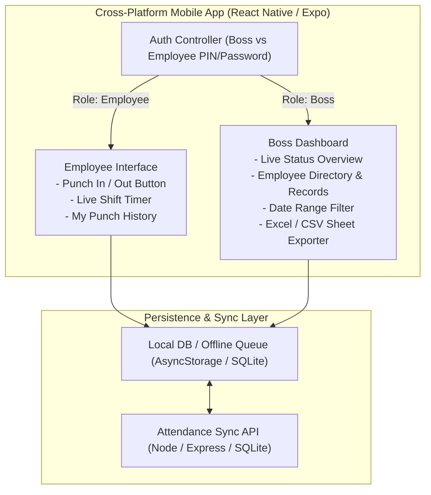

# Design Document: Employee Punch Clock & Attendance Mobile App

**Date:** 2026-11-16  
**Status:** Draft (Pending Builder Check & Approval)  
**Target Platform:** Mobile App (React Native / Expo for iOS, Android, and Web)

---

## 1. Intent and Why
Small and medium business owners need a reliable, friction-free way to track employee working hours without expensive hardware biometric clocks. Employees need a fast, transparent way to clock in and out from their mobile devices, while the employer ("Boss" / Master account) requires real-time visibility from anywhere and the ability to export full, audit-ready attendance sheets (Excel/CSV) for payroll and compliance.

---

## 2. Goals, Non-Goals, & Anti-Goals

### Goals
- **Role-Based Authentication**: Secure access separation between Boss (Master Administrator) and individual Employee accounts.
- **Frictionless Punch In / Punch Out with Photo Verification**: When employees punch in/out, they take a mandatory verification photo (selfie / worksite photo) to prove they are physically on site rather than at home, alongside location coordinates and timestamp.
- **Boss Live Monitoring & Photo Audit**: Real-time overview of who is currently working, when they clocked in, with instant access to inspect each punch's verification photo.
- **Attendance Sheet Export**: One-tap export to formatted Excel (`.xlsx`) and `.csv` files via native device sharing (WhatsApp, Email, Drive, etc.).
- **Manual Adjustment & Overrides**: Boss can manually add/edit/correct missed punches with change audit notes.
- **Offline Resilience**: Local caching so employees can punch even if offline, syncing when connectivity resumes.

### Non-Goals
- Full payroll salary processing and tax deductions (the app exports raw attendance, hours, and overtime to feed into payroll systems).
- In-app video surveillance or invasive background GPS tracking (only punch-time geolocation capture).

### Anti-Goals
- Cluttered, multi-step navigation for employees (punching in must take < 3 seconds).
- Locked proprietary spreadsheet formats (must export standard Excel and CSV).

---

## 3. Approaches Considered & Trade-offs

| Approach | Architecture | Pros | Cons | Decision |
| :--- | :--- | :--- | :--- | :--- |
| **Approach 1 (Picked)** | **React Native (Expo) + Shared API/Local SQLite Sync** | Instant testing on physical iOS/Android phones via Expo Go; seamless native file sharing (`expo-sharing`, `xlsx`); can also run on web browser | Initial setup requires Expo toolchain | **Selected by user** |
| **Approach 2** | React + Capacitor Native Shell | Direct DOM tables; rapid prototyping | Less smooth native animations and mobile gestures compared to native primitives | Rejected |
| **Approach 3** | Flutter (Dart) + Firebase | High frame rates | Heavy local SDK requirements and dart dependencies | Rejected |

---

## 4. System Architecture & Tech Stack

### Tech Stack Details
- **Mobile Framework**: React Native with Expo SDK
- **Styling**: NativeWind (Tailwind CSS for React Native) or React Native Paper with consistent design tokens
- **Camera & Photo Capture**: `expo-camera` / `expo-image-picker` with front/rear camera toggle, automatic compression for lightweight sync and storage
- **Data & Storage**: SQLite / AsyncStorage for resilient local storage + lightweight backend sync server
- **Spreadsheet Generation**: `xlsx` (SheetJS) for `.xlsx` and custom `.csv` generator
- **Sharing & Export**: `expo-sharing` & `expo-file-system` to share sheets directly to email, WhatsApp, or cloud storage
- **Location**: `expo-location` to capture geocoordinates at the exact moment of punch

---

## 5. Screen Layouts & User Workflows

### A. Employee Experience (Personal Phone / BYOD)
1. **Device Setup & Login**: 
   - Initial launch prompts for **Company Code** (or pre-configured default for single-company setup) + **Employee ID / Email** + **4-digit PIN**.
   - Session remains persistently logged in on the employee's personal phone with biometric / quick unlock.
2. **Punch Screen & Photo Verification Flow**:
   - Prominent status indicator: **CLOCKED OUT** (Red) vs **CLOCKED IN** (Green).
   - Tap "PUNCH IN" or "PUNCH OUT" -> opens camera verification modal.
   - Employee takes a quick photo (front camera selfie / worksite proof).
   - Shows thumbnail confirmation with captured GPS location.
   - Tap "Confirm Punch" -> stores punch event with timestamp, compressed photo URI/base64, and coordinates.
   - When punched in: displays active work shift timer (`04h : 22m : 15s`).
3. **My History**: List of past punches with date, time in, time out, photo thumbnail, and total hours worked.

### B. Boss (Master Account) Experience
1. **Master Login**: Master email / username + password.
2. **Live Overview**:
   - Summary cards: Total Employees, Currently Working, Absent Today, Total Hours logged.
   - Live roster cards showing each employee's status, punch time, and latest worksite photo thumbnail.
3. **Attendance Reports & Photo Audit**:
   - Filter by date range (Today, Yesterday, This Week, This Month, Custom).
   - Filter by individual employee or department.
   - Detailed punch log table: Employee Name, Date, In Time, Out Time, Total Hours, Overtime, Location map link, and **Photo Inspection button**.
   - Tapping an employee's photo opens full-screen zoomable photo with embedded timestamp, location badge, and employee details.
4. **Sheet Export**:
   - Button: "Export Full Excel Sheet (.xlsx)" or "Export CSV".
   - Generates formatted summary sheet with columns: `Employee ID`, `Name`, `Date`, `Punch In`, `Punch Out`, `Total Hours`, `Notes`, `Photo Verified (Yes/No)`, `Location`.
   - Triggers native OS share sheet.
5. **Staff Management**:
   - Add new employees, assign PINs, deactivate accounts.
   - Edit/Add missed punch records with audit trail.

---

## 6. Technical Decisions (Builder Calls)
- **Data Model (Event-Based Punches)**: Punches are stored as timestamped events (`PUNCH_IN`, `PUNCH_OUT`) rather than rigid single-session rows. This seamlessly supports multiple punches per day (e.g., lunch breaks), calculating active duration and flagging overtime (>8 hours/day) automatically.
- **Dual-Mode Backend Architecture**: 
  - **Standalone / Demo Mode**: Runs immediately out of the box with seeded accounts (Boss + 3 Employees) and local SQLite persistence, requiring zero server setup to test.
  - **Full-Stack REST Backend**: Includes a ready-to-run Node/Express + SQLite API for synchronized multi-device data sharing across different phones.
- **Offline Integrity**: Punches logged without an active internet connection are stored in a local queue and uploaded upon reconnection, tagged with an `offline_logged: true` audit marker visible in the Boss report.

---

## 7. What's Left to the Builder
- UI theme customization, micro-animations, and haptic feedback tuning.
- Sound effects on punch in/out.

