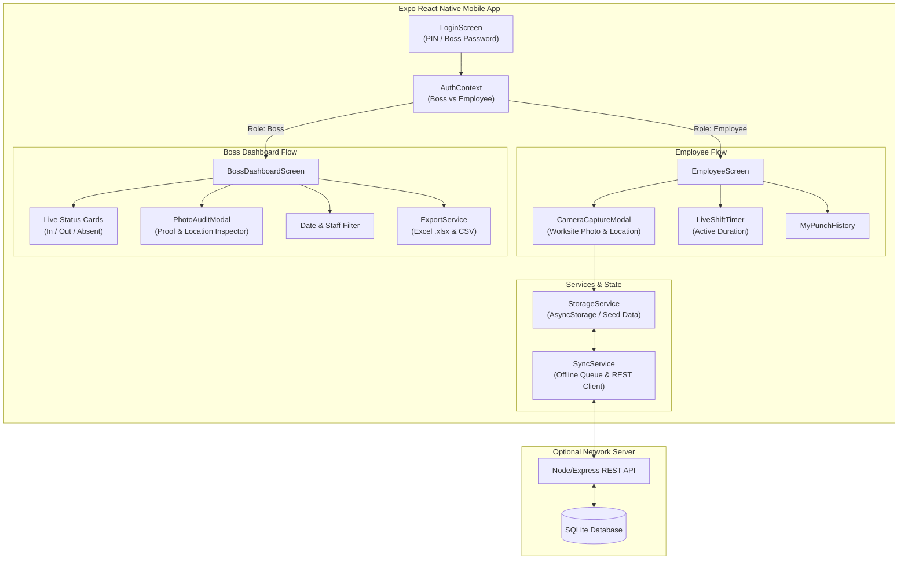

# Employee Punch Clock & Attendance Mobile App Implementation Plan

> **For agentic workers:** REQUIRED SUB-SKILL: Use superpowers:subagent-driven-development (recommended) or superpowers:executing-plans to implement this plan task-by-task. Steps use checkbox (`- [ ]`) syntax for tracking.

**Goal:** Build a complete cross-platform mobile application (React Native / Expo) for company attendance tracking, featuring employee photo-verified punch-in/out, live shift duration tracking, a Master Boss dashboard with real-time employee monitoring and photo auditing, and one-tap export to formatted Excel (`.xlsx`) and CSV sheets.

**Architecture:** The client is built with Expo (React Native) supporting iOS, Android, and Web preview. It uses an event-based punch data model (`PUNCH_IN`, `PUNCH_OUT`), camera integration for worksite selfie verification, and local-first storage with an offline sync queue. An included Node/Express + SQLite REST server provides optional multi-device network synchronization, while built-in seed data allows immediate out-of-the-box demo testing.

**Architecture Diagram:**



**Tech Stack:** React Native (Expo SDK), TypeScript, `expo-camera`, `expo-location`, `expo-file-system`, `expo-sharing`, `xlsx` (SheetJS), `@react-native-async-storage/async-storage`, Lucide Icons (`lucide-react-native`), Express + SQLite (Backend).

**Spec:** `docs/superpowers/specs/2026-11-16-employee-punch-clock-mobile-app-design.md`

## Global Constraints
- Target platforms: Cross-platform iOS, Android, and Web preview via Expo.
- Punch verification: Mandatory worksite camera capture (selfie/site photo) + timestamp + GPS coordinates.
- Reporting: Export must generate native `.xlsx` (Excel) workbook and `.csv` files shareable via native OS share sheet.
- Resilient operation: Standalone demo mode with seeded Boss & Employee accounts works immediately without external server configuration.
- Multiple punches per day: Support multiple in/out cycles (e.g. lunch breaks) and automatic daily hours and overtime (>8 hrs) aggregation.

## Review Focus
1. **Camera Permission Denial**: When camera access is rejected, display clear guidance dialog and graceful fallback.
2. **Offline Punch Queueing**: When punches are taken without internet, queue punches locally and automatically sync with `offline_logged: true` audit flag upon reconnect.
3. **Empty / Incomplete Punches**: Employees who punched in but forgot to punch out are highlighted on Boss dashboard as "Currently Active (Overnight / Unclosed)" rather than crashing calculation logic.
4. **Excel Export Formatting**: Ensure exported Excel headers, total hours formulas, timestamps, and column widths are cleanly styled for standard spreadsheet software.
5. **Cross-Platform Storage**: AsyncStorage works seamlessly on both mobile native engines and web browser environments.

---

## File Structure

```
├── package.json
├── app.json
├── babel.config.js
├── tsconfig.json
├── src/
│   ├── types/
│   │   └── attendance.ts           # Types: Employee, PunchRecord, ShiftSummary, AuthState
│   ├── services/
│   │   ├── storage.ts              # Local persistence, initial seed data, CRUD
│   │   ├── calculation.ts          # Shift hours, overtime, daily rollups
│   │   ├── exportService.ts        # Excel (.xlsx) & CSV generation + native share
│   │   └── syncService.ts          # Offline sync queue & REST API client
│   ├── context/
│   │   └── AuthContext.tsx         # User session, login, role determination
│   ├── components/
│   │   ├── PunchButton.tsx         # Tactile clock in/out trigger button
│   │   ├── LiveShiftTimer.tsx      # Real-time ticking shift counter
│   │   ├── CameraCaptureModal.tsx  # Worksite photo capture modal
│   │   ├── PhotoAuditModal.tsx     # Boss high-res photo inspection modal
│   │   └── StatCard.tsx            # Dashboard summary metric widget
│   ├── screens/
│   │   ├── LoginScreen.tsx         # Unified Employee PIN & Master Boss login
│   │   ├── EmployeeScreen.tsx      # Employee punch screen & personal log
│   │   └── BossDashboardScreen.tsx # Boss overview, filters, live roster, export
│   └── App.tsx                     # Navigation container & root provider
├── server/
│   ├── server.js                   # Node/Express API with SQLite
│   └── package.json                # Server dependencies
└── tests/
    ├── calculation.test.ts         # Unit tests for hours & overtime calculations
    ├── exportService.test.ts       # Unit tests for CSV & XLSX generation
    └── storage.test.ts             # Unit tests for punch state transitions & queue
```

---

## Tasks

### Task 1: Project Setup, Dependencies, and Core Data Types
**Files:**
- Create: `package.json`
- Create: `tsconfig.json`
- Create: `app.json`
- Create: `src/types/attendance.ts`
- Test: `tests/types.test.ts`

**Interfaces:**
- Produces: `Employee`, `PunchRecord`, `ShiftSummary`, `CompanyConfig`, `PunchType` in `src/types/attendance.ts`.

- [ ] **Step 1: Write type contract tests in `tests/types.test.ts`**
- [ ] **Step 2: Run test to verify it fails**
- [ ] **Step 3: Create `package.json` with Expo, React Native, XLSX, and testing scripts**
- [ ] **Step 4: Implement TypeScript definitions in `src/types/attendance.ts`**
- [ ] **Step 5: Run tests and verify they pass**
- [ ] **Step 6: Commit**

---

### Task 2: Attendance Calculation & Shift Duration Engine
**Files:**
- Create: `src/services/calculation.ts`
- Test: `tests/calculation.test.ts`

**Interfaces:**
- Consumes: `PunchRecord`, `ShiftSummary` from `src/types/attendance.ts`.
- Produces: `calculateDailyHours(punches: PunchRecord[]): ShiftSummary`, `formatDuration(ms: number): string`, `isOvertime(hours: number): boolean`.

- [ ] **Step 1: Write failing tests in `tests/calculation.test.ts`** (testing multiple in/out punches, open punch sessions, overtime calculations).
- [ ] **Step 2: Run tests to verify failure**
- [ ] **Step 3: Implement calculation functions in `src/services/calculation.ts`**
- [ ] **Step 4: Run tests to verify all tests pass**
- [ ] **Step 5: Commit**

---

### Task 3: Local Storage, Offline Queue, and Seed Data Manager
**Files:**
- Create: `src/services/storage.ts`
- Test: `tests/storage.test.ts`

**Interfaces:**
- Consumes: `Employee`, `PunchRecord` from `src/types/attendance.ts`.
- Produces: `getEmployees()`, `getPunchRecords()`, `addPunchRecord()`, `seedInitialData()`, `updatePunchRecord()`.

- [ ] **Step 1: Write failing tests in `tests/storage.test.ts`** (testing punch creation, initial seed population, offline pending flags).
- [ ] **Step 2: Run tests to verify failure**
- [ ] **Step 3: Implement storage and seed data in `src/services/storage.ts`**
- [ ] **Step 4: Run tests to verify all pass**
- [ ] **Step 5: Commit**

---

### Task 4: Spreadsheet Export Engine (Excel `.xlsx` and CSV)
**Files:**
- Create: `src/services/exportService.ts`
- Test: `tests/exportService.test.ts`

**Interfaces:**
- Consumes: `PunchRecord`, `Employee`, `ShiftSummary` from `src/types/attendance.ts` and `src/services/calculation.ts`.
- Produces: `generateCsvReport()`, `generateExcelReport()`, `shareAttendanceReport()`.

- [ ] **Step 1: Write failing tests in `tests/exportService.test.ts`** (verifying header columns, row calculations, photo verified flag, valid CSV formatting).
- [ ] **Step 2: Run tests to verify failure**
- [ ] **Step 3: Implement SheetJS Excel `.xlsx` and CSV generation in `src/services/exportService.ts`**
- [ ] **Step 4: Run tests to verify all pass**
- [ ] **Step 5: Commit**

---

### Task 5: Authentication Context & Session Management
**Files:**
- Create: `src/context/AuthContext.tsx`
- Test: `tests/auth.test.ts`

**Interfaces:**
- Consumes: `Employee` from `src/types/attendance.ts`, `storage.ts`.
- Produces: `useAuth()`, `loginBoss()`, `loginEmployee()`, `logout()`.

- [ ] **Step 1: Write failing tests in `tests/auth.test.ts`** (authenticating Boss with master password, authenticating employee with 4-digit PIN).
- [ ] **Step 2: Run tests to verify failure**
- [ ] **Step 3: Implement `AuthContext.tsx`**
- [ ] **Step 4: Run tests to verify all pass**
- [ ] **Step 5: Commit**

---

### Task 6: UI Components (PunchButton, LiveShiftTimer, CameraCaptureModal, PhotoAuditModal)
**Files:**
- Create: `src/components/PunchButton.tsx`
- Create: `src/components/LiveShiftTimer.tsx`
- Create: `src/components/CameraCaptureModal.tsx`
- Create: `src/components/PhotoAuditModal.tsx`
- Create: `src/components/StatCard.tsx`

**Interfaces:**
- Consumes: `PunchRecord` from `src/types/attendance.ts`.
- Produces: Reusable mobile UI components for camera verification, live timer, tactile punch button, and boss photo inspector.

- [ ] **Step 1: Implement `PunchButton.tsx` with haptic feedback and dynamic clocked-in/out styling**
- [ ] **Step 2: Implement `LiveShiftTimer.tsx` with real-time interval timer**
- [ ] **Step 3: Implement `CameraCaptureModal.tsx` with camera capture preview, flash/flip controls, and GPS coordinates tag**
- [ ] **Step 4: Implement `PhotoAuditModal.tsx` for Boss inspection with full-screen photo and timestamp/location metadata**
- [ ] **Step 5: Implement `StatCard.tsx` metric card widget**
- [ ] **Step 6: Commit**

---

### Task 7: Employee Screen & Punch Flow with Worksite Photo
**Files:**
- Create: `src/screens/EmployeeScreen.tsx`
- Modify: `src/App.tsx`

**Interfaces:**
- Consumes: `useAuth()`, `PunchButton`, `LiveShiftTimer`, `CameraCaptureModal`, `storage.ts`.
- Produces: Employee dashboard with 1-tap punch, live shift timer, camera proof modal, and personal punch history.

- [ ] **Step 1: Build `EmployeeScreen.tsx` layout and punch state handling**
- [ ] **Step 2: Wire photo capture verification to punch-in and punch-out lifecycle**
- [ ] **Step 3: Integrate personal punch history table with photo thumbnails**
- [ ] **Step 4: Verify employee flow in Expo / web runner**
- [ ] **Step 5: Commit**

---

### Task 8: Master Boss Dashboard, Live Monitoring, and Sheet Export
**Files:**
- Create: `src/screens/BossDashboardScreen.tsx`
- Modify: `src/App.tsx`

**Interfaces:**
- Consumes: `useAuth()`, `storage.ts`, `calculation.ts`, `exportService.ts`, `PhotoAuditModal`.
- Produces: Complete Boss administrative portal with live status roster, date/employee filters, photo inspector, and Excel/CSV export trigger.

- [ ] **Step 1: Build summary cards (Total Staff, Punched In Now, Punched Out, Total Hours)**
- [ ] **Step 2: Build live employee roster showing real-time status and latest punch photo thumbnail**
- [ ] **Step 3: Add date range and employee filter controls**
- [ ] **Step 4: Integrate one-tap Excel (`.xlsx`) & CSV export via `shareAttendanceReport`**
- [ ] **Step 5: Integrate `PhotoAuditModal` for tap-to-inspect worksite photos**
- [ ] **Step 6: Commit**

---

### Task 9: Login Screen, Root Navigation, and End-to-End Verification
**Files:**
- Create: `src/screens/LoginScreen.tsx`
- Create: `src/App.tsx`
- Create: `server/server.js` (Optional Node/Express SQLite sync server)
- Create: `README.md` (Quickstart guide with Expo Go instructions)

**Interfaces:**
- Integrates all components into a polished mobile application.

- [ ] **Step 1: Build `LoginScreen.tsx` with role toggle (Employee PIN entry vs Boss Master login) and quick-demo login buttons**
- [ ] **Step 2: Connect `App.tsx` navigation stack between Login, Employee, and Boss screens**
- [ ] **Step 3: Create `server/server.js` for optional REST sync**
- [ ] **Step 4: Execute test suites (`npm test`) and verify all tests pass**
- [ ] **Step 5: Test web preview and verify responsive rendering and spreadsheet generation**
- [ ] **Step 6: Commit**
